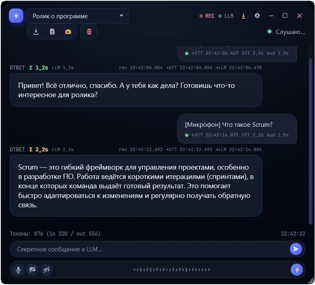
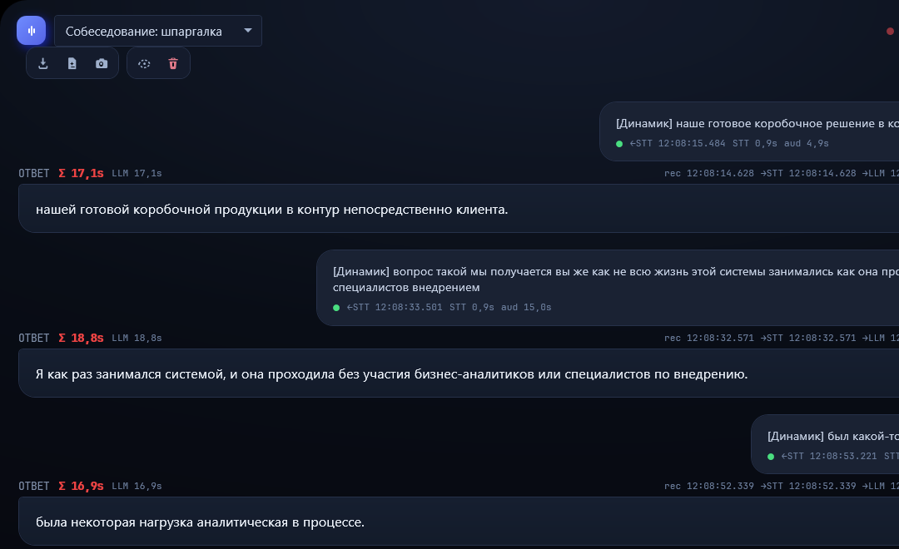
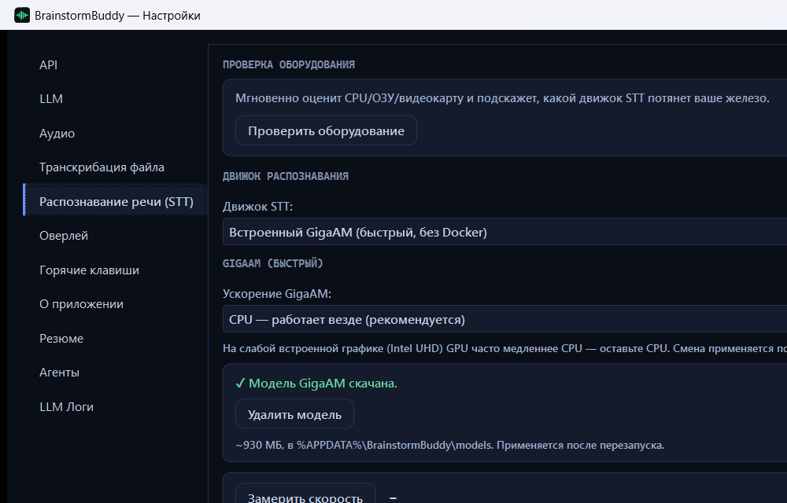
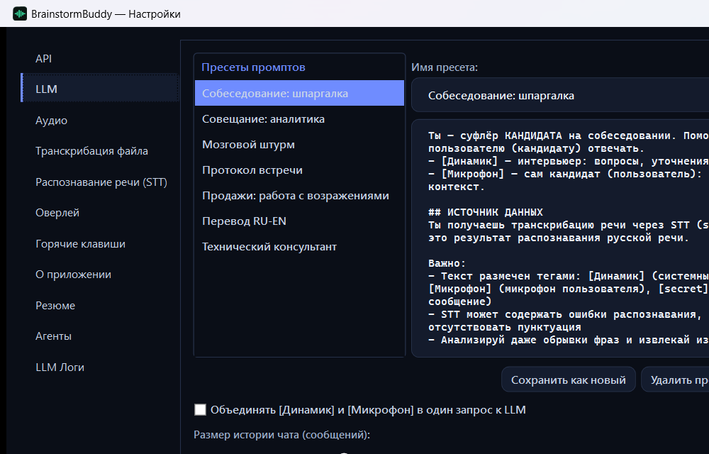
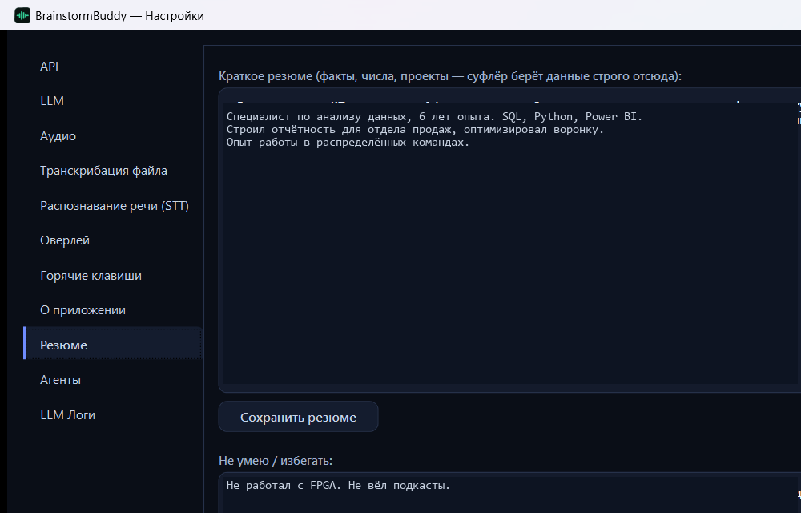
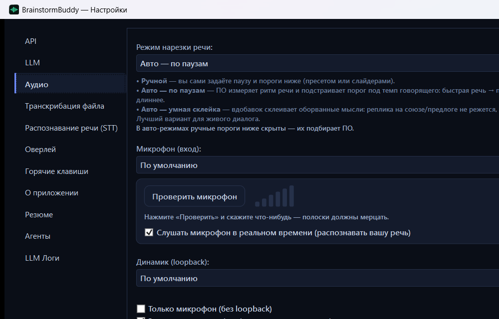
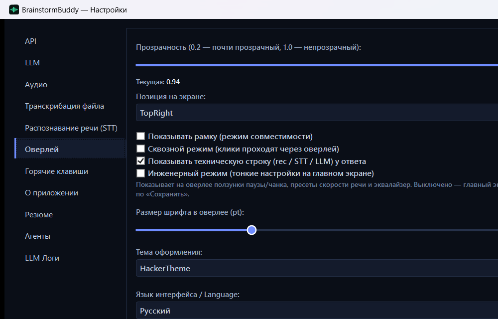
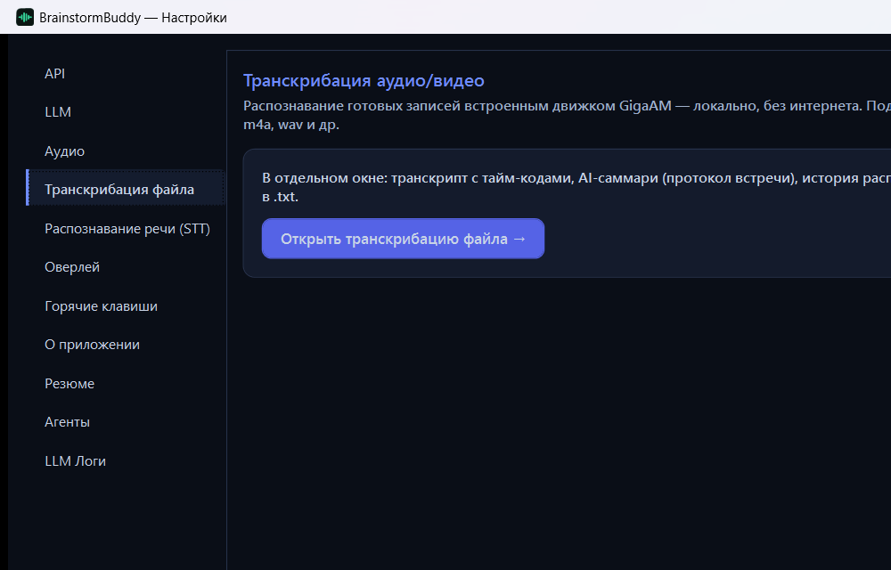

<div align="right"><a href="README.md">Русский</a> · <b>English</b></div>

<div align="center">

# 🧠 BrainstormBuddy

### The invisible assistant for live calls

**It hands you ready-made answers right during an interview, a sales call or negotiations. An overlay on top of the screen that is invisible in Zoom and in recordings. Runs offline on your computer or with your own server — your choice.**



<sub>On the right, real questions recognized from the call. On the left, ready answers from the AI. Only you can see any of it.</sub>

   

</div>

---

## Why you need it

A job interview, a call with a client, tough negotiations. A question catches you off guard, and a couple of seconds of silence decides the outcome. There is no time to google, and paid services send their summaries only **after** the meeting, when it is too late.

BrainstormBuddy works in real time and stays invisible. It listens to the conversation, recognizes the other party's speech and within seconds puts a ready answer on your screen, phrased from your resume. The other side asked to see your screen? They will not see the suggestions: the overlay is excluded from capture at the OS level (Zoom, Teams, Google Meet, Yandex Telemost, OBS, screenshots).

All recognition and all generation can run right on your computer, without the cloud. And if you need maximum speed and quality, the app connects to any external recognition server and any language model. The choice is yours.

## What makes it special
- 🥷 **Invisible to recordings and screen sharing.** The overlay is excluded from capture at the OS level, so it is absent from the call and from the other side's screenshots. One button (or `Ctrl+Shift+C`) hides it even from you, if you want to take a screenshot yourself.
- ⚡ **A hint in real time, not meeting minutes afterwards.** The question is asked, and a couple of seconds later a ready line is already on the screen. Answers **stream** word by word — you read them before the model finishes. STAR format for project questions, a short gist for theory ones.
- 🔒 **Speech recognition runs locally** (GigaAM or Whisper). The language model is any OpenAI-compatible provider: local (LM Studio, LocalAI) or cloud. If you wish, you connect your own external STT.
- 🎯 **Answers from your resume, no inventions.** The assistant takes facts, projects and figures strictly from your profile. If it does not know the answer, it honestly stays silent instead of inventing experience.
- 🎙️ **It separates you from the other party on its own.** System audio (the other party) and the microphone (you) go through separate channels, so the AI understands who asked the question.
- 🗣️ **Diarization: it labels who is speaking.** Utterances are tagged `[S1]`, `[S2]`, `[S3]`… right inside the line — you can see where the interviewer's question ends and your answer begins. Works offline (Nemotron, no network).
- 👀 **Screen OCR: reads questions right off the screen.** Opened a PDF or a test during the interview — the assistant recognizes the text on the screen by itself and answers the questions in the frame, even when you are just scrolling the document. `Ctrl+Shift+N` — recognize right now, `Ctrl+Shift+X` — turn watching on/off. Without sound.
- 🧠 **Buddy Memory: your fact base with local embeddings.** The assistant remembers facts about you, projects and people, weaves them into answers and records new ones on the “write to memory” command. Semantic search runs on local e5 embeddings, no cloud. Memory Center, Meeting History, a pre-meeting briefing. `Ctrl+Shift+M` — ask memory.
- 📺 **Karaoke teleprompter.** A separate strip overlay with a feed of hints: new answers slide in from the bottom and age. The same stealth and click-through — only you can see it. `Ctrl+Shift+K`.
- 🕶️ **Process stealth mode.** The app can run under a neutral process name (`notion`, `helper`…) — no “BrainstormBuddy” showing in Task Manager.
- 🧩 **Any recognition engine with automatic switching.** Built-in GigaAM (fast, Russian, no Docker), Whisper large-v3 (accuracy and punctuation, better on a GPU), a local Docker server or your own external server. If one is unavailable, the app switches to another by itself.
- 🌍 **Russian and English.** GigaAM is tuned for Russian speech. Need English or mixed language — pick Whisper and get English recognition. The interface is fully available in Russian and English.
- 🎛️ **Smart speech segmentation.** Auto mode adapts the pause to the speaker's pace, does not cut a phrase mid-word and does not lag.

## What it looks like

<p align="center"></p>

## How it works

```
🎧 The other party's audio (loopback)  ┐
🎤 Your microphone                     ┘→  speech segmentation  →  recognition  →  assistant  →  🫥 overlay (for your eyes only)
```

1. The app listens to system audio and the microphone through two separate channels.
2. Speech is segmented on pauses (the threshold adapts automatically) and goes to recognition.
3. The recognized question from the other party reaches the assistant, which phrases a ready line from your resume.
4. The answer appears on a transparent overlay on top of all windows, invisible to screen recording.

## Download and install

> ### 👉 [Download from the releases page](https://github.com/liveinno/brainstorm-buddy/releases)

There are two installer versions — pick one:

| Version | What's inside | Size |
|---|---|---|
| **`BrainstormBuddy-Setup-Full.exe`** (recommended) | The app + offline **GigaAM and Whisper** models — everything works without internet right away, including file transcription and English | ~1 GB |
| **`BrainstormBuddy-Setup-Lite.exe`** | The app + **GigaAM** (the live assistant offline). Whisper is downloaded on first use of file transcription | ~0.5 GB |

1. Open the releases page via the link above.
2. Download **Full** (everything offline) or **Lite** (lighter, downloads Whisper when needed).
3. Run the downloaded file. If Windows shows the blue SmartScreen window, click **“More info” → “Run anyway”** (this is normal for apps without a paid publisher signature).
4. Go through the installation wizard (Next, Next, Install). A shortcut appears on the desktop and in the Start menu.
5. Launch the app and go through the short built-in tutorial.

📘 **English user guide:** [PDF](docs/manuals/UserGuide_BrainstormBuddy_2.39.2_EN.pdf) · [DOCX](docs/manuals/UserGuide_BrainstormBuddy_2.39.2_EN.docx)

Uninstallation is standard: **Windows Settings → Apps → BrainstormBuddy → Uninstall**, or the “Uninstall” shortcut in the Start menu. Your settings and saved files are not touched during uninstallation.

<details>
<summary>Building from source (for developers)</summary>

```bash
dotnet restore
dotnet build -c Release
dotnet publish BrainstormBuddy/BrainstormBuddy.csproj -c Release -r win-x64 --self-contained true -o publish/
```

The language model is any OpenAI-compatible service: local (LM Studio, LocalAI) or cloud. By default the app uses cloud OpenCode Go (`deepseek-v4.1-flash`) — only an API key is needed.

Building the installers (Lite and Full, Inno Setup):

```bash
bash packaging/build-installer.sh   # → installer-inno/BrainstormBuddy-Setup-{Lite,Full}.exe
```

Before that, put the GigaAM model into `artifacts/gigaam/v2_ctc.onnx` (how to get it from the primary source — [`tools/gigaam_export`](tools/gigaam_export)): the `artifacts/` directory is not stored in git. Details and pitfalls — in [`docs/INSTALLER.md`](docs/INSTALLER.md).
</details>

## 🔐 Where the models come from and how to verify

Both recognition models are taken from official open sources under the MIT license. The full list of components and licenses is in [`THIRD-PARTY-NOTICES.txt`](THIRD-PARTY-NOTICES.txt).

| Model | Official source | License |
|---|---|---|
| **GigaAM v2 (CTC)** — Russian recognition, the live assistant | [github.com/salute-developers/GigaAM](https://github.com/salute-developers/GigaAM) (SberDevices) | MIT |
| **Whisper large-v3-turbo (ggml, q5_0)** — file transcription, English | [huggingface.co/ggerganov/whisper.cpp](https://huggingface.co/ggerganov/whisper.cpp/blob/main/ggml-large-v3-turbo-q5_0.bin) | MIT |

The app **never downloads anything in the background without your knowledge**: in the Full version both models are already bundled, in Lite Whisper is downloaded directly from HuggingFace only via a button in the settings (the address is visible in the app and in the source code).

How to verify yourself:

- **Checksums.** The [releases page](https://github.com/liveinno/brainstorm-buddy/releases) publishes `SHA256SUMS.txt` with the hashes of the installers and models. After installation the models sit in the app folder, `models` subfolder (by default `%LOCALAPPDATA%\Programs\BrainstormBuddy\models`). Hash of any file: `Get-FileHash "<path>" -Algorithm SHA256` in PowerShell.
- **Whisper** — exactly the official file from HuggingFace: the hash can be checked right against the model page (HF shows the SHA256 for each file).
- **GigaAM** — an ONNX export of Sber's official model, produced by an open script from this same repository: [`tools/gigaam_export`](tools/gigaam_export). Sber does not publish a ready-made ONNX, so no external “reference” exists — but the export is reproducible: install the official `gigaam` pip package, run our script and get the same model straight from the primary source.

## Settings

Everything is configured in **Settings** (`Ctrl+Shift+S`). Below are the sections worth knowing about.

### Speech recognition (STT)



The main engine choice. **“Built-in GigaAM” works out of the box**: fast, Russian, no internet and no Docker, the model is already part of the installation. Whisper large-v3 is more accurate and adds punctuation and English, but is heavier (better on a GPU). There is also a local Docker server and your own external server. The **“Check the speed”** button shows how fast your exact hardware recognizes speech.

### LLM (language model)



Here you choose the assistant's brain and the presets for scenarios (Interview, Meeting, Sales, Brainstorm, Translation and others).

> **⚠️ Important note about the model.** The default is `deepseek-v4.1-flash` via OpenCode Go — a fast “flash” model, answers arrive in 1–2 seconds, an API key is required. **For confidential calls connect a local model (LM Studio/LocalAI): the text does not go to anyone else's server, but on an ordinary laptop it thinks longer and answers more plainly.** A local model is a trade-off for privacy, not top quality.

### Resume



Your profile: experience, projects, figures, plus what to avoid. The assistant takes facts strictly from here, so the more thoroughly you fill it in, the more accurate and honest the answers.

### Audio



Speech segmentation mode (manual or auto, with smart gluing of cut-off thoughts), microphone and system audio selection, microphone test.

### Overlay



Opacity, position, font size, theme (dark or light), interface language. Also here — **engineer mode**: off by default, so the main screen stays clean. Enable it if you want to see the fine sliders and the equalizer.

## Transcribing ready-made recordings



Besides the live assistant there is a separate mode for already recorded meetings. The app recognizes ready-made audio and video (mp4, m4a, wav, webm and others) with the built-in GigaAM engine, locally and without internet. **Multi-file queue** — select several files at once, they are processed in turn, each gets its own record. A separate window holds the full transcript with time codes and speaker tags, an AI summary in the form of meeting minutes (the prompt is editable), the recognition history, export to `.txt` and the “Extract to memory” button. The recognition hardware is chosen there too: auto, CPU or a specific GPU. Opened from **Settings → “File transcription”**.

## Memory and history

**Buddy Memory** stores facts about you, projects and conversation partners — locally, on e5 embeddings. The assistant automatically weaves memory into answers, and you can ask it directly (`Ctrl+Shift+M`) or make it record something new (“write to memory: …”). Before a call it shows a **briefing** on the active project.

**Memory Center** — viewing, searching, editing and bulk deletion of facts, project management. **Meeting History** — a journal of all calls with transcripts, summaries and bulk deletion.

## Privacy

By default nothing leaves your machine until you point it at an external server or a cloud model yourself. Local mode keeps on your computer the audio, recognition, OCR, diarization, memory embeddings and generation. Transcript and minutes export goes to your “Documents” folder.

## Keyboard shortcuts

| Keys | Action |
|---|---|
| `Ctrl+Shift+H` | Show or hide the overlay |
| `Ctrl+Shift+C` | Screenshot mode (show the overlay to capture and back) |
| `Ctrl+Shift+S` | Open settings |
| `Ctrl+Shift+O` | Change opacity |
| `Ctrl+Shift+P` | Pause audio |
| `Ctrl+Shift+Y` | Pause the AI |
| `Ctrl+Shift+K` | Karaoke teleprompter on/off |
| `Ctrl+Shift+X` | Screen OCR on/off |
| `Ctrl+Shift+N` | OCR — recognize the screen right now |
| `Ctrl+Shift+M` | Ask Memory |
| `Ctrl+Shift+G` | Memory on/off for the meeting |
| `Ctrl+Shift+T` | Restore the tray icon |
| `Ctrl+Shift+L` | Logs window |

## System requirements

Windows 10 (build 18362 or newer) or Windows 11. A microphone and system audio. For a local language model — any OpenAI-compatible server (LM Studio, LocalAI). For GPU-accelerated Whisper — a discrete graphics card.

## License

MIT: free use, modification and distribution (including commercial) provided the license text and copyright are preserved. See [`LICENSE`](LICENSE).

## Stack

C# 12 · .NET 8 · WPF · NAudio · ONNX Runtime (GigaAM, multilingual-e5) · whisper.cpp · Nemotron (diarization) · WinRT/Tesseract OCR · OpenAI-compatible HTTP.
